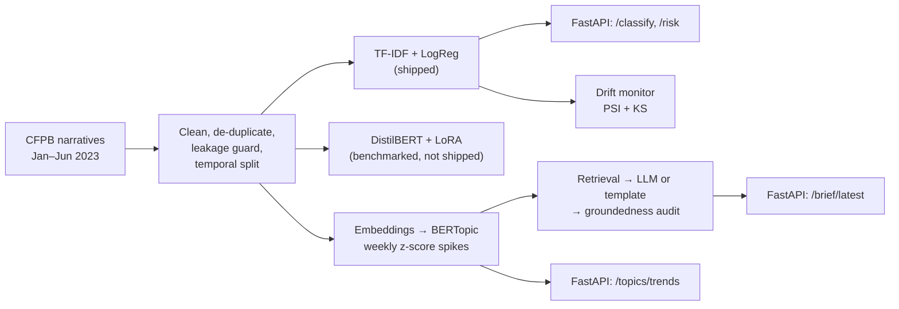

# Complaint Intelligence Platform

[](https://github.com/Jayendra70/complaint-intelligence/actions/workflows/tests.yml)

An end-to-end NLP system over real CFPB consumer complaints. It classifies each
complaint by product, scores the risk that it ends in monetary relief, detects
emerging issues week by week, writes citation-backed weekly briefs, and serves
the models through a FastAPI service with drift monitoring.

## Results

**Data.** 234,719 CFPB complaint narratives from Jan–Jun 2023, reduced to
173,468 after removing 61,251 near-duplicate template letters. Temporal split:
138,774 complaints for training (Jan 1 – May 24) and 34,694 for testing
(May 24 – Jun 30), so the test set is always the future. The product model
trains on a class-balanced sample of 47,121; the test set keeps its natural mix.
Details: [`data/DATA_CARD.md`](data/DATA_CARD.md).

| Task | Metric | TF-IDF + LogReg (shipped) | DistilBERT + LoRA |
|---|---|---|---|
| Product classification (9 classes) | macro-F1 | 0.7065 | **0.7386** |
| Monetary-relief risk (3.0% positive in test) | PR-AUC | **0.3337** (≈11× the 0.030 random baseline) | 0.3308 |

**The transformer story** ([`reports/phase3_findings.md`](reports/phase3_findings.md)).
The first DistilBERT + LoRA run scored 0.6832 macro-F1 and lost to the baseline.
It had corrected class imbalance twice (balanced sampling *and* class weights)
and early-stopped on a balanced validation set. Fixing both and raising the LoRA
rank from 8 to 16 lifted it to 0.7386, 3.2 points above the baseline (single
run, no seed-variance check yet). It wins 7 of 9 classes, most on Student loan
(F1 0.606 → 0.762; [`reports/error_analysis_report.md`](reports/error_analysis_report.md)).

**Why the baseline ships anyway.** On monetary-relief risk the two models tie,
so the transformer's only gain is +0.032 product F1, and it needs the PyTorch +
Transformers + PEFT stack and a GPU to be fast. The baseline is one
scikit-learn pipeline that scores a median-length complaint in about 2.8 ms
on a 2-thread CPU, or under 1 ms per complaint in batches
([`reports/latency_report.md`](reports/latency_report.md)).

**Emerging issues** ([`reports/topics_report.md`](reports/topics_report.md)).
Sentence-Transformers embeddings → BERTopic (UMAP + HDBSCAN) on a 40,000-narrative
sample: 40 topics and 54 topic-week spikes (≥ 2 standard deviations above the
trailing 6-week mean, with ≥ 15 complaints). Re-fitting with another seed gives an
Adjusted Rand Index of 0.755. The largest spike (z = 21.5, week of 2023-01-16) is
a cluster of Wells Fargo loan-modification denials.

**Weekly brief** ([`reports/phase5_findings.md`](reports/phase5_findings.md)).
Retrieval picks representative complaints for each spiking topic, then an LLM
(via Groq) or an offline template writes the brief. A groundedness audit fails a
brief if it cites any complaint ID that was not in the evidence or has any factual
line without a citation. The template briefs pass. The LLM brief for the week of
2023-01-16 fails: 5 of its 11 claim lines (the headline and the recommendations)
carry no citation. Making the prompt cite on every line is the next fix.

## How it fits together



## Run it

```bash
python -m venv venv && source venv/bin/activate
pip install -r requirements-serving.txt pytest httpx   # API + tests only (no torch)
uvicorn src.serving.app:app --reload                   # http://localhost:8000/docs
pytest                                                 # 14 tests
python -m src.serving.bench_latency                    # CPU latency of the shipped models
```

The two shipped models are committed (`models/*.joblib`, pickled with
scikit-learn 1.9.0, which `requirements-serving.txt` pins). So `/classify`,
`/risk` and `/brief/latest` work straight after cloning, and 8 of the 14 tests
run. The other 6 tests, `/topics/trends` and the drift check need the processed
data, which is gitignored: run notebooks 00 → 01 → 06 to download and build it
(`pip install -r requirements.txt` for the full environment). To retrain the
shipped models: `python -m src.serving.train_baseline`.

Experiments were tracked in MLflow: the baselines locally (experiment
`phase2_baselines_6mo`) and the transformer runs on Colab. The tracking stores
stay local; the transformer runs are summarized in
[`reports/mlflow_runs.md`](reports/mlflow_runs.md).

## Notebooks (the modelling pipeline, in order)

1. `00_data_download.ipynb` — pull real CFPB data
2. `01_data_cleaning.ipynb` — clean, label, de-duplicate, temporal split → parquet
3. `02_eda.ipynb` — regenerate `reports/eda_report.md` + figures
4. `03_baseline.ipynb` — TF-IDF + LogReg baselines (locked)
5. `04_transformer_colab.ipynb` — DistilBERT + LoRA (Colab T4)
6. `05_error_analysis.ipynb` — per-class F1, disagreements, truncation, company-name probe
7. `06_topics_over_time.ipynb` — emerging-issue detection

## Design decisions worth reading

- **Escalation target:** the CFPB dropped `Consumer disputed?` in 2017; the
  proxy-label decision and its trade-offs are in `reports/target_decision_memo.md`.
- **Leakage guard:** the response and timeliness fields that *define* the label
  are dropped from the processed parquet files.
- **Temporal split:** train on the past, test on the future, as in production.
- **Ship the cheaper model:** the transformer edged the baseline on product but
  tied on monetary relief, and the baseline is a light CPU model, so it ships.

## Limitations

- Only ~26 weeks of history, so emerging-issue spikes are illustrative, not
  battle-tested.
- `/classify` confidence is not calibrated (balanced LogReg is over-confident):
  use it for routing, not as a true probability.
- The drift monitor's product reference is the balanced training mix, so natural
  data legitimately shows high product PSI. Set the reference to the production
  mix for real use (`reports/phase6_findings.md`).
- The groundedness audit checks that cited IDs exist and that lines carry
  citations. It does not check that each cited complaint supports the sentence.
- The transformer's product win is a single run without a seed-variance check.
- Narrative subset only: conclusions do not transfer to complaints without text.
- Latency was measured on a 2-thread cloud VM; rerun `bench_latency` on your
  machine for local numbers.

## Future work

The full, phase-by-phase backlog with a priority shortlist is in
[`FUTURE_WORK.md`](FUTURE_WORK.md); serving and monitoring detail is in
`reports/phase6_findings.md`.
