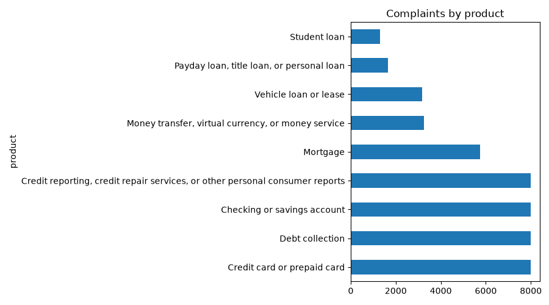
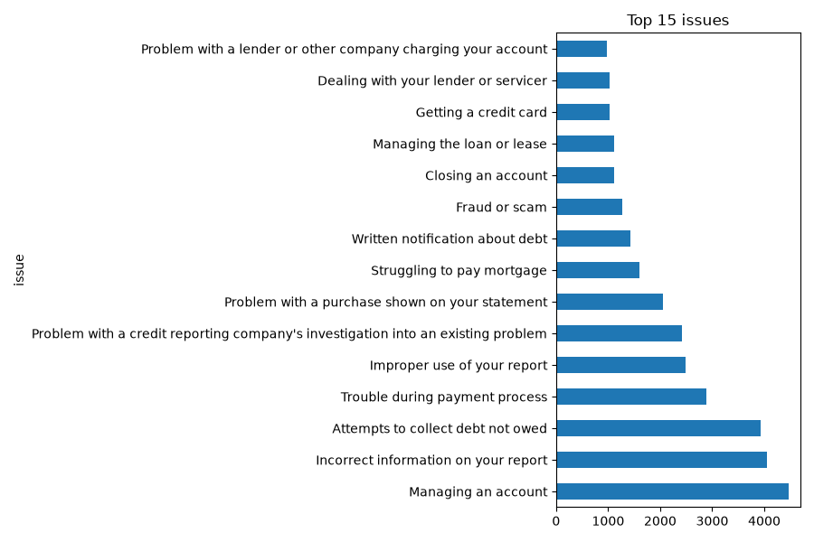
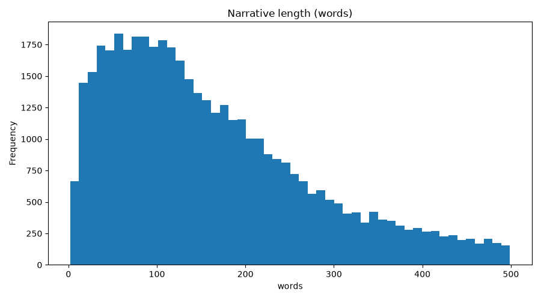
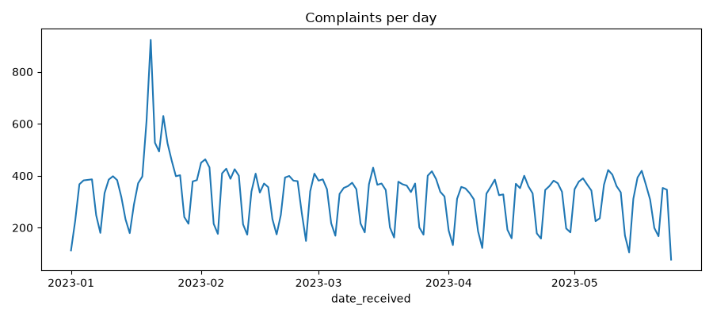
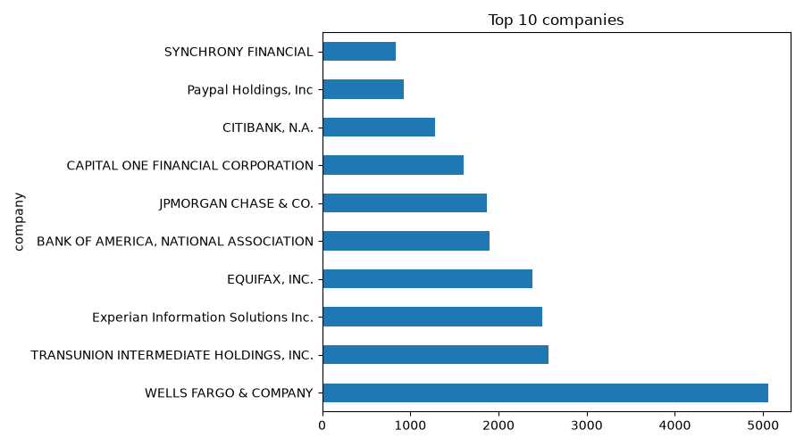
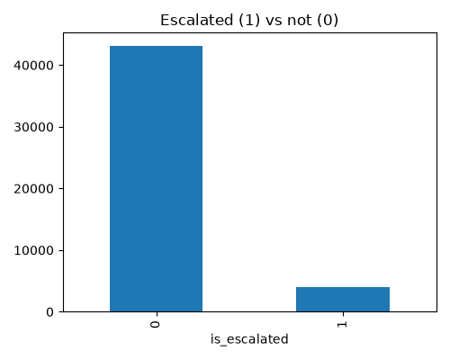

# EDA Report — CFPB Complaint Narratives

Based on the cleaned training data (47121 complaints). The test set is
kept aside and not looked at here.

## Main points

- Only **36.9%** of complaints have a written narrative (people opt in), so
  the data leans toward more motivated or frustrated customers.
- Biggest product category: **Credit card or prepaid card** (17.0% of complaints).
  The categories are very unbalanced, so we report macro-averaged scores later.
- Escalation rate: **8.54%** — very few, so the data is imbalanced and
  we care about PR-AUC and threshold tuning, not plain accuracy.
- Narrative length: about **149** words typically; 95% are under
  **619** words (~866 tokens). Some are longer than BERT's
  512-token limit, so truncation is a real choice we make in Phase 3.
- **82.5%** of narratives contain "XXXX" (blacked-out personal info).
- The top 10 companies make up **44.4%** of all complaints.

## Charts

