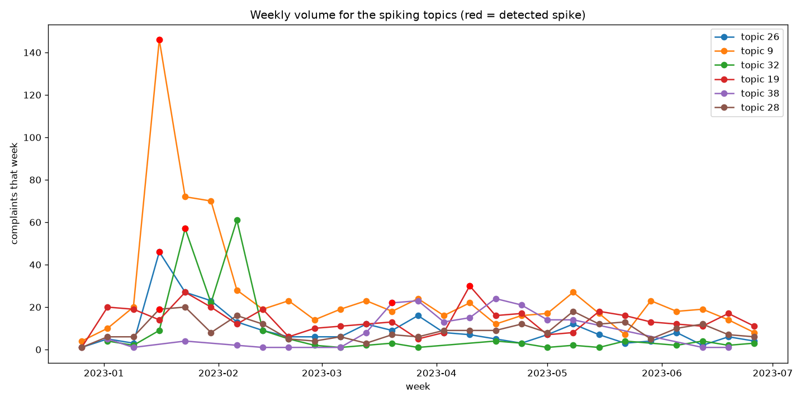

# Emerging-issue detection

Generated by `notebooks/06_topics_over_time.ipynb` on 2026-08-13.

Method: all-MiniLM-L6-v2 embeddings -> BERTopic (UMAP + HDBSCAN) -> weekly topic volumes -> rolling z-score spike detection.

## Data

- Narratives used: 40000 (random sample of 173468 six-month complaints; SAMPLE_SIZE=40000).
- Date range: 2023-01-01 to 2023-06-30.

## Topics

- Topics found: 40.
- Outliers (no clear topic, -1): 38.9%.

Biggest topics:

```
 Topic  Count                                                  Name
    -1  15550                  -1_credit_information_report_account
     0   3835                      0_debt_collection_company_credit
     1   3064                             1_bank_card_account_money
     2   1337                       2_inquiries_inquiry_hard_credit
     3   1171                        3_mortgage_loan_payment_escrow
     4    861                              4_15 usc_usc_15_consumer
     5    836                            5_car_vehicle_loan_payment
     6    789                      6_accounts_account_credit_report
     7    766                  7_section_1681 section_1681_usc 1681
     8    761                       8_15 usc_usc_account account_15
     9    706                       9_fargo_wells_wells fargo_money
    10    691                            10_balance_items_theft_000
    11    649                11_late_payments_payment_late payments
    12    638 12_balance_products services_want dispute_challenging
    13    637              13_balance_records_questioning_acquiring
```

## Detected spikes (emerging issues)

Rule: a topic's weekly count is >= 2.0 standard deviations above its own trailing 6-week average, with at least 15 complaints that week.

- Total topic-week spikes: 54.

Top spikes:

```
 topic       week  count  z_score
    26 2023-01-16     46    21.50
     9 2023-01-16    146    16.66
    32 2023-01-23     57    14.42
    19 2023-04-10     30     6.89
    38 2023-03-20     22     6.88
    28 2023-01-16     19     5.08
    28 2023-05-08     18     4.72
    12 2023-02-27     37     4.63
    15 2023-03-06     51     4.27
    14 2023-06-05     36     4.20
```

## Case studies

- **Topic 26** (wells, fargo, wells fargo, mortgage, loan, home) spiked the week of 2023-01-16: 46 complaints, z-score 21.5.
- **Topic 9** (fargo, wells, wells fargo, money, account, bank) spiked the week of 2023-01-16: 146 complaints, z-score 16.66.
- **Topic 32** (cc, inquiry, date inquiry, account number, immediately, number) spiked the week of 2023-01-23: 57 complaints, z-score 14.42.
- **Topic 19** (addresses, address, credit, report, inaccurate, information) spiked the week of 2023-04-10: 30 complaints, z-score 6.89.
- **Topic 38** (consumer reports, use social, unauthorized use, declare, alleging, penalty perjury) spiked the week of 2023-03-20: 22 complaints, z-score 6.88.
- **Topic 28** (account, limitation, money, email, transaction, permanent) spiked the week of 2023-01-16: 19 complaints, z-score 5.08.

## Stability

Refitting on the same embeddings with a different seed gave 39 topics (vs 40), Adjusted Rand Index 0.755 (1.0 = identical grouping). Topic *numbers* change between runs; the broad themes are what stay stable.

## Figure



## Limitations

- Only ~26 weeks of history, so spike detection is illustrative, not battle-tested.
- Topic assignments are unsupervised and shift with the seed (see Stability). Use the themes, not the exact topic ids.
- A random sample was embedded for speed; raising SAMPLE_SIZE steadies the weekly counts.
